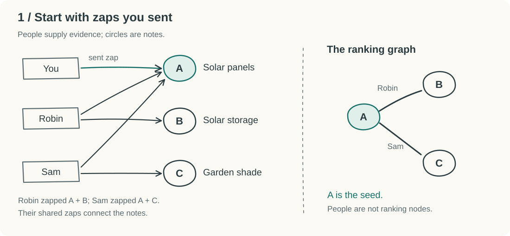
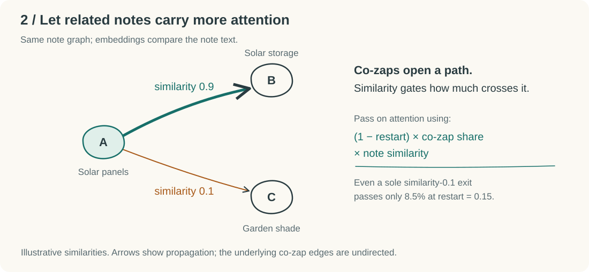
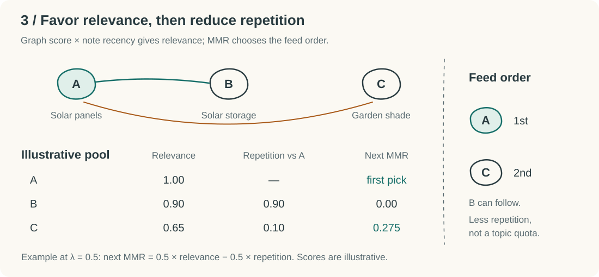

# SemanticWOT

A personalized Nostr feed powered by shared zaps and semantic similarity.
Enter your public key, follow collection progress, and read recommended notes in
a local browser app. No login, signing, or private key is needed.

## Start locally

Install Docker with Compose (Docker Desktop or Docker Engine plus the Compose
plugin). The app needs network access to Nostr relays and **one external embedding
provider**. Docker supplies Node and SQLite; the app does not start Ollama or
download models.

```sh
git clone https://github.com/SwimmingRieux/SemanticWOT.git
cd SemanticWOT
```

Choose one provider:

| Provider | Prerequisite and configuration |
| --- | --- |
| OpenAI | Copy `examples/openai.env` to `.env`, then replace `OPENAI_API_KEY` with your key. Defaults: `text-embedding-3-small`, 1536 dimensions. Public note text goes to the configured service; API usage may cost money. |
| Ollama | Install and start Ollama separately, run `ollama pull nomic-embed-text` there, then copy `examples/ollama.env` to `.env`. Defaults: `nomic-embed-text`, 768 dimensions. No OpenAI key is needed. |

```sh
# OpenAI:
cp examples/openai.env .env
# Edit .env to supply your key before starting.

# Or, after installing/pulling the model on your external Ollama host:
# cp examples/ollama.env .env

docker compose up --build -d
```

Open **http://localhost:3000** and enter your npub or hex public key. Keep `.env`
private. An explicitly configured `WOT_ENDPOINT` selects Ollama and takes priority;
omit that setting entirely for OpenAI (an empty value is invalid). OpenAI uses
`WOT_OPENAI_ENDPOINT=https://api.openai.com/v1`. Failures never switch providers.
Model, dimensions, version, and batch size can be overridden in the runtime file.

The Ollama example uses `http://host.docker.internal:11434`. Docker Desktop supplies
that hostname; Compose maps it to the host gateway on native Linux. A native Linux
Ollama listener bound only to `127.0.0.1` is **not reachable** through that mapping:
configure Ollama to listen on a container-reachable interface and restrict access
with your host firewall. See [Docker setup](docs/docker.md) for exact host binding,
remote endpoint, configuration, tracing, and troubleshooting instructions.

## Saved feeds and limits

First use collects evidence and embeds notes. Stage names and counts show actual
work, without a percentage or ETA. Closing the tab leaves backend work running;
reopening the key reconnects. One key processes at a time, while saved feeds remain
readable. Another key receives a busy message and can retry later.

The Docker volume keeps completed feeds and reusable SQLite cache data across
ordinary restarts. Reopening a processed key shows its saved feed and age.
**Refresh feed** explicitly collects again, keeping the previous result visible
during work and after failure. Restarting interrupts active work; retry through
the shown action to reuse safe cached inputs. `docker compose down` keeps the
volume; `docker compose down -v` deletes saved feeds and cache.

The packaged defaults use only `wss://nos.lol`, with caps of **20 seed zaps,
20 co-zappers, and 20 outgoing zaps per co-zapper**. Increase `WOT_MAX_SEED_ZAPS`,
`WOT_MAX_CO_ZAPPERS`, and `WOT_MAX_ZAPS_PER_CO_ZAPPER` for broader collection;
adjust both `WOT_RELAYS` and `WOT_MAX_RELAYS` to use more relays. Caps limit new
collection, not all retained cache evidence. No usable sent note-zaps means an
empty feed with no follow-based fallback. Sparse relay evidence can also produce
few notes. There is no promise of complete discovery, recommendation quality,
or a universal first-run time. Check relay/provider settings and retry after
dependency failures. Profile and image failures leave text readable; remote media
loads directly in your browser and its host can observe those requests.

## How recommendations work

**1. Start with your sent note-zaps.** In this invented example you zapped A.
Robin also zapped A and B; Sam zapped A and C. Shared curators provide the evidence
connecting notes. Only notes are ranking nodes; people are evidence boxes.
Larger, newer seed zaps carry more weight, with diminishing weight for amount.



**2. Guide a walk with text similarity.** Embeddings compare note text along
existing co-zap edges. The similarity-gated local-push walk passes attention using
each edge's co-zap strength share, multiplied by similarity and `1 − restart`.
It records a fixed restart fraction at each push, then normalizes recorded scores.
A sole weak exit stays weak; similar text alone creates no edge.



**3. Balance relevance and repetition.** Note age discounts graph scores. MMR
selects from the top relevance pool, balancing relevance against the greatest
similarity to any already selected note. Its default balance is 50/50: C can come
before B because B closely resembles A. Seed notes can remain candidates.



Notes, receipts, and compatible embeddings are reusable cache data, including
across viewers. These sketches describe bounded evidence and ranking mechanics,
not resistance to coordinated manipulation. The [short walkthrough](docs/recommendations.md)
explains propagation, recency, numerical stopping, and MMR in more detail.

## Library and development

The TypeScript library and JSON CLI remain available. For local development use
Node 24+ and the native SQLite build prerequisites supported by `better-sqlite3`:

```sh
npm ci
npm run typecheck
npm test
npm run test:integration
npm run test:browser
npm run build
node dist/cli.js feed <npub-or-hex> --config wot.example.toml --refresh
node dist/cli.js feed <npub-or-hex> --config wot.example.toml --offline
```

Routine tests use fake capabilities or controlled local services, with synthetic
signed fixtures and dummy keys. They need no live relay, real model, or paid API.
[Browser setup](test/browser/README.md) describes Chrome/Chromium prerequisites;
[Docker acceptance](test/docker/README.md) is an explicit separate infrastructure check.

See [configuration](docs/configuration.md), [providers](docs/embedding-providers.md),
[embedding/cache identity](docs/embeddings.md), [indexing and refresh](docs/indexing.md),
[cache maintenance](docs/cache-maintenance.md), [frozen evaluation](docs/evaluation.md),
[web runtime/library composition](docs/web.md), and [optional traces](docs/observability.md).
The project is licensed under [MIT](LICENSE).
