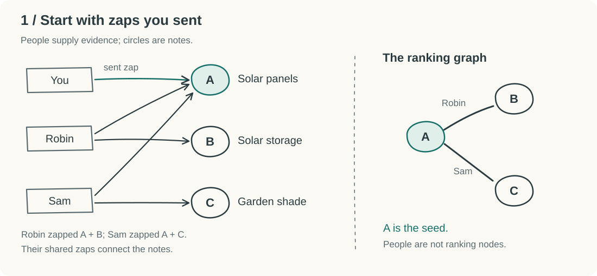
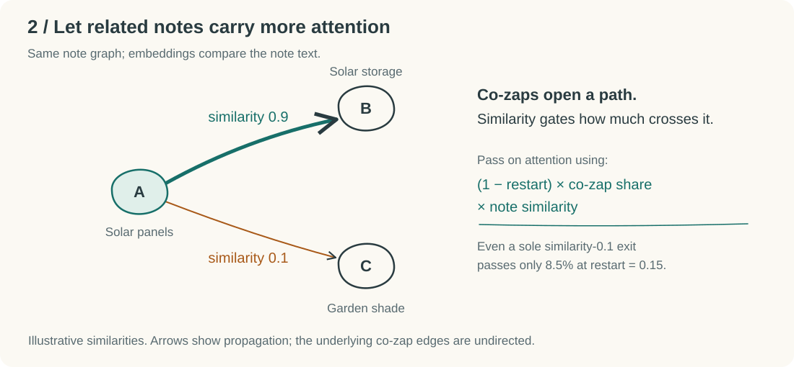
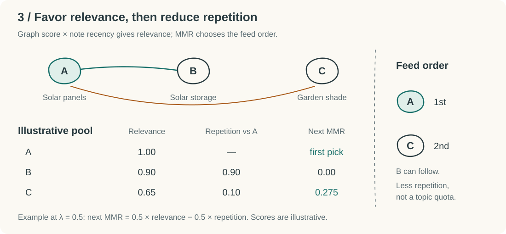

# How recommendations work

SemanticWOT follows shared zaps to discover notes, then uses their text to guide
ranking and reduce repetition. Here is a small, invented example; its scores
illustrate the mechanics, not measured recommendation quality.

## 1. Your sent zaps establish a starting point

You sent a zap to **A**, a note about solar panels. That makes A a **seed**.
Larger and more recent sent zaps contribute more, with diminishing weight for
amount and a default 30-day half-life for zap age. Zaps you receive do not seed
your feed. No usable sent note-zaps means an empty result.

Robin also zapped A, and zapped **B** about solar storage. Sam zapped A and **C**
about garden shade. These shared curators supply evidence for the A–B and A–C
connections. Each curator contributes the smaller of their total amounts on the
two notes. **Only notes are ranking nodes**; people and authors are evidence or
metadata. Profile zaps do not enter this graph.

## 2. Similarity gates propagation

An embedding model converts chunks of note text into vectors. Comparing them
produces a symmetric similarity from 0 to 1. Similarity guides attention along
existing shared-zap connections; similar text alone does not create an edge.

The **similarity-gated local-push walk** starts at the seeds. It divides outgoing
co-zap strength into shares, then multiplies each share by similarity and
`1 − restart` (default restart: `0.15`). A weak connection carries less attention
even when it is the only exit: similarity `0.1` passes just `8.5%`. The walk model
returns restart and rejected attention to the seed distribution.

Local push computes the scores by repeatedly taking pending attention at a note,
recording the fixed restart fraction there, and passing gated attention to its
neighbors. It normalizes the recorded scores at the end to estimate stationary
visits. Processing stops when little pending attention remains or a safety cap is
reached; hitting that cap does not establish convergence.

## 3. Make a relevant, less repetitive feed

Graph scores are discounted by **note age**, with a default 180-day half-life.
The top relevance candidates form a pool (default: 200). Seed notes can remain
candidates, as A does here.

**MMR** picks the highest-relevance note first. For each next pick, it balances
relevance against repetition: the greatest similarity to any note already picked.
In the illustration, C moves ahead of B because B closely resembles A. Relevance
is divided by the pool's maximum once, before selection. The default balance is
`0.5 × relevance − 0.5 × repetition`; increasing the balance toward 1 favors
relevance, while decreasing it favors less repetition after the first pick.
Selection returns up to 20 notes by default, without a minimum-quality cutoff or
a guaranteed mix of authors or topics.

Fetched notes, zap receipts, and compatible embeddings are reusable local cache
data, including across viewers. Saved feeds can be reopened; explicit refresh
collects new evidence. Changing embedding identity requires compatible vectors.

Everything depends on **bounded evidence** from the configured relays and
collection limits. Missing receipts, unavailable notes, and small caps can make
a feed short or empty; an empty query is not proof that no zaps exist elsewhere.
The sketches explain a recommendation model, not comprehensive discovery,
guaranteed quality, or a defense against coordinated manipulation.
